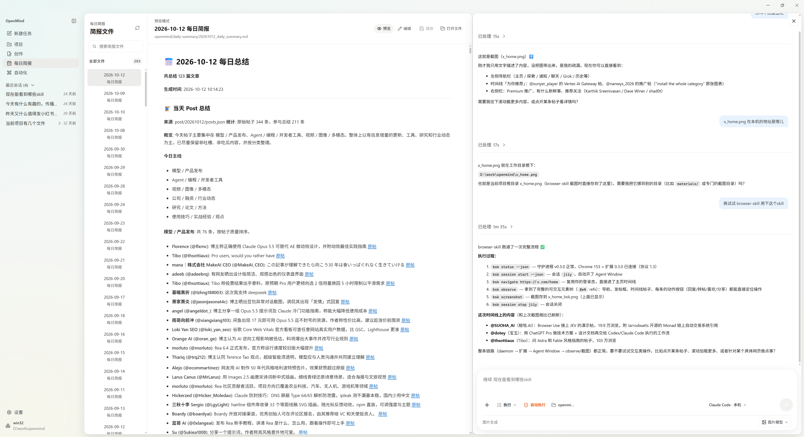
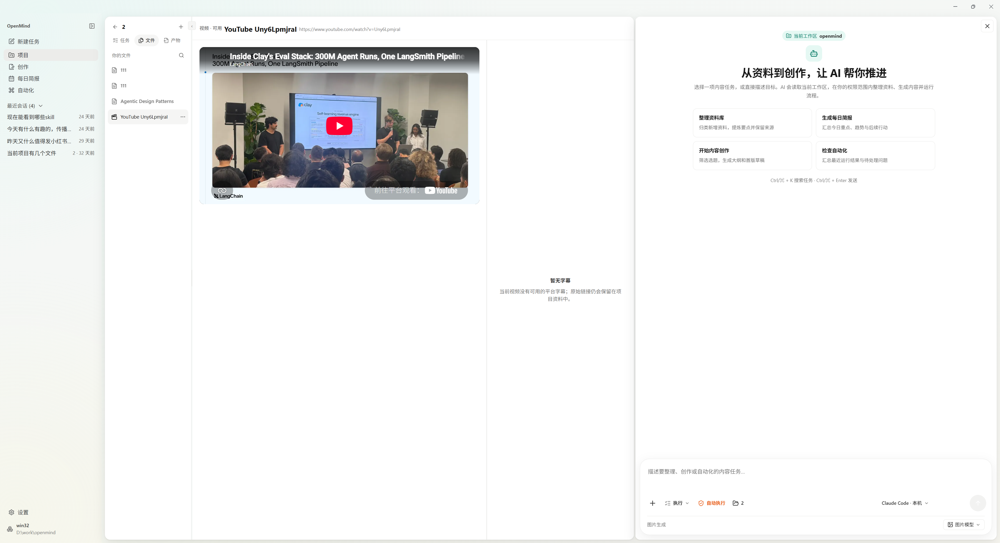
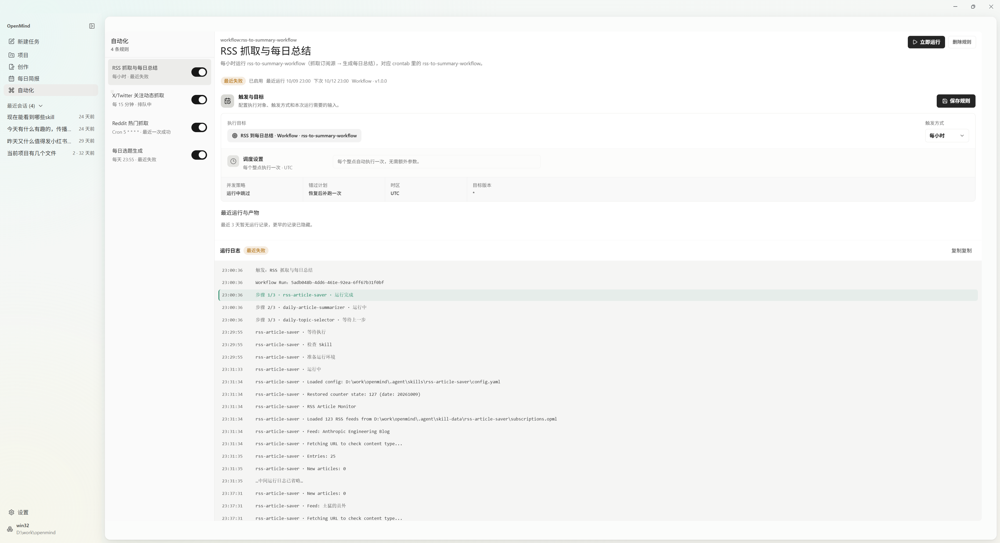
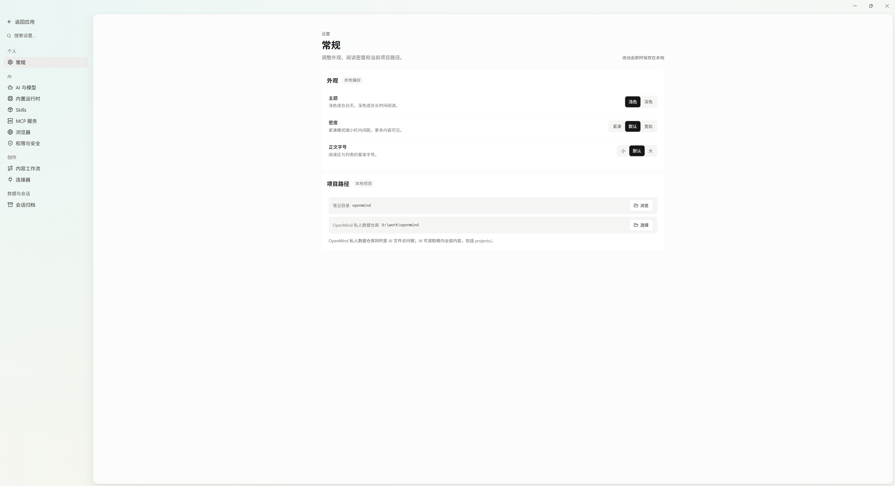

# OpenMind Desktop

[English](README.md) | 简体中文

OpenMind Desktop 是一个面向信息收集、知识整理和 AI 内容创作的个人工作台。它把 RSS 订阅、本地资料库、AI 摘要和写作项目放在同一个桌面应用里，帮助你把每天读到的内容整理成笔记和文章草稿。

## 项目亮点

- **203 个精选 RSS 源。** 官方 [Skill 库](https://github.com/SebastianLavertheDe/cctools-skills) 包含 122 个普通订阅和 81 个公众号订阅，覆盖 AI、科技、工程等领域。首次安装后即可使用，也可以调整自己的订阅。
- **手动添加资料。** 支持将网页 URL、PDF 文件和 YouTube 视频链接添加到项目中，集中整理资料并用于阅读和写作。
- **从阅读到写作。** 把文章保存为 Markdown，生成每日摘要和选题，再用收集的资料撰写草稿、推进创作项目。
- **自由配置 AI。** 使用自己的 AI Provider 完成摘要和写作，也可以连接 Claude Code 或 Codex CLI 开始 AI 会话。
- **通过 Skill 扩展。** 官方库提供 RSS、Reddit、X、知识库编译和写作工作流，也支持从 Git 仓库、ZIP 或本地目录安装更多 Skill。
- **公众号导出。** 预览文章排版、复制富文本，并将草稿推送到已配置的微信公众号。
- **文件由你掌握。** 文章、笔记和草稿保存在自己选择的本地文件夹中，Markdown 文件也可以用其他编辑器打开和修改。

## 界面预览

**每日简报与 AI 会话。** 浏览每日摘要，在文档旁与 AI 讨论正在阅读的内容。



<details>
<summary>项目资料：集中整理阅读与写作素材</summary>

把资料放在同一个项目中，在 AI 工作台旁预览 YouTube 视频来源。下图展示的是暂无可用平台字幕的视频。



</details>

<details>
<summary>自动化：定时运行工作流，查看执行情况</summary>

配置定时采集与摘要工作流，也可以手动运行，并查看状态和执行日志。下图包含一次失败运行，展示问题排查时可查看的信息。



</details>

## 如何使用

桌面分发目标是 Windows 11 和 macOS；Linux 可用于开发和测试。

### 首次启动

1. **选择数据目录。** 选择保存 OpenMind 内容和个人配置的文件夹。
2. **安装官方 Skill。** 在首启引导中点击 **安装 RSS 源**，应用会安装 [cctools-skills](https://github.com/SebastianLavertheDe/cctools-skills)，提供 RSS 采集能力和默认订阅。安装需要联网，这一步完成后才能进入工作台。
3. **配置 AI。** 在 **设置 → AI 与模型** 中添加 AI Provider，填写 Base URL、API Key 和文本模型，并选择默认 Provider。使用 AI 会话时，还需要安装或连接 Claude Code / Codex CLI，并按应用提示完成连接配置。首启时也可以选择 **稍后配置**，需要 AI 功能时再补充。
4. **开始采集和创作。** 在设置中调整订阅，在技能中心运行 RSS 采集或 RSS 到摘要工作流，再到资料库阅读结果，并用于写作项目。

AI 功能会向你配置的 Provider 发送请求。请使用自己的凭据，并将数据目录和 Provider 配置保留为私人数据。

<details>
<summary>设置预览：外观与本地数据目录</summary>

在 **设置 → 常规** 中调整主题、显示密度和正文字号，并选择 OpenMind 数据目录。



</details>

### 从源码启动

准备 **Node.js 22.12+**、**Git** 和 **uv**，然后运行：

```bash
git clone https://github.com/SebastianLavertheDe/openmind-app.git
cd openmind-app
npm ci
npm run prepare:python-runtime
npm run dev:electron
```

运行时准备步骤会下载 Skill 使用的 Python 运行时。应用打开后，按上面的首次启动流程完成设置。

开发约定见 [AGENTS.md](AGENTS.md)。更多说明：[AI 工作台](docs/AI_WORKSPACE.md)、[公众号导出](docs/wechat-export.md)、[支持与恢复](docs/SUPPORT_AND_RECOVERY.md)。

## 许可证

OpenMind Desktop 采用 [OpenMind Desktop Community License 1.0](LICENSE)，公开源码并允许以下用途：

- **个人使用、企业内部使用与修改、商业内容创作免费。** 可以用它接单，销售使用它创作的文章、报告、视频等许可范围内的内容。
- **允许非商业免费分发原版或修改版。** 分发时需附带许可证、保留适用声明，并标明修改。
- **软件本身的商业化需另行取得书面授权。** 包括售卖或商业分发软件、将软件或其代码纳入商业软件产品，以及向外部用户提供商业托管服务；靠广告变现的服务也在此范围内。
- **创作内容不被要求分成、加水印、署名或公开源码。** 第三方素材、依赖和独立分发的 Skill 仍按各自适用条款处理。

这是带有商业限制的源码可见社区许可证，不属于 OSI 认可的开源许可证。以上为说明摘要，正式条款以 `LICENSE` 中的英文原文为准。商业授权请联系[仓库维护者](https://github.com/SebastianLavertheDe/openmind-app)。

## TODO

- [ ] **完善视频工作流：** 进一步完善视频下载、转写、摘要与写作素材的衔接，提升桌面端的完整使用体验。
- [ ] **扩展内容来源与 Skill：** 持续维护默认 RSS 源，增加更多采集和写作工作流。
- [ ] **简化首次配置：** 改善 Skill 和运行时安装、离线使用以及下载中断后的恢复体验。
- [ ] **完善桌面分发：** 持续改善 Windows/macOS 打包、兼容性和日常使用体验。
