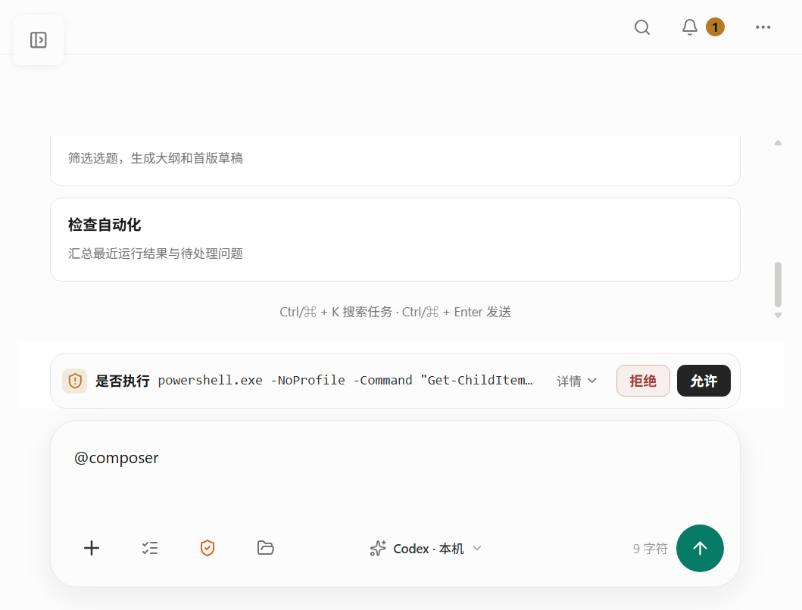
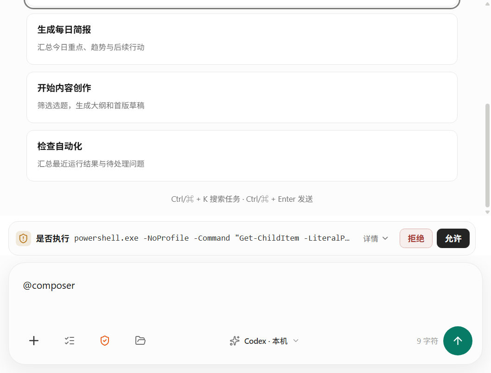

# OpenMind Desktop `better-interface` 全量审查与整改报告

审查时间：2026-09-13（Asia/Shanghai）  
整改完成：2026-09-13（Asia/Shanghai）  
结论：**Approve（9 / 9 项已修复）**  
审查类型：当前工作树的仓库级 UI / 交互 / 动效审查与全量整改，不做提交状态归因。

## Remediation status

本轮按用户要求处理原报告的 HIGH、MEDIUM、LOW 全部问题，并以包含所有已提交与未提交代码的当前工作树为准。原始审查结论保留在下方作为整改前基线；当前发布判断以本节和文末 Verdict 为准。

| # | Severity | Finding | Resolution | Verification |
| --- | --- | --- | --- | --- |
| 1 | HIGH | 简报搜索框无可访问名称 | 输入框使用消息表中的稳定 `aria-label`，搜索图标从辅助技术树隐藏 | Daily Brief 可访问名称测试通过 |
| 2 | HIGH | 窄屏简报被自动打开的 AI canvas 覆盖且缺少可见退出 | canvas 布局不再自动展开 AI；AI companion 所有模式增加可见的关闭入口，wide / fullscreen 增加显式模式切换入口 | 720 / 840px 行为测试与视觉矩阵通过 |
| 3 | HIGH | `--muted-2` 对比度不足 | 浅色调整为 `#626260`，深色调整为 `#9c9c96`；新增覆盖实际表面的颜色契约 | `npm run color:check` 通过，两主题所有受检表面 ≥ 4.5:1 |
| 4 | MEDIUM | 嵌套 `main` 地标 | AppShell 保留唯一 `<main>`，七个功能页内层改为 `<section>` | App landmark 测试通过；生产 Renderer 仅剩一个 `<main>` |
| 5 | MEDIUM | 两组 tablist 缺少方向键与 roving focus | 创作编辑/预览与设置 Skills/MCP 统一复用共享 `Tabs` | Arrow、Home、End 与焦点测试通过 |
| 6 | MEDIUM | 项目 compact 选择后焦点掉到 body | 选择任务/文件关闭列表后，把焦点恢复到“展开项目列表”按钮 | 1480px compact 自动选择与回焦测试通过 |
| 7 | MEDIUM | 自动化初始加载失败无宣告与恢复 | 使用共享 `ErrorState`，提供 `role="alert"` 和“重试”动作 | 首次失败、宣告、重试成功测试通过 |
| 8 | MEDIUM | 10–11.5px 小字号分散硬编码 | caption / xs / metadata 下限统一为 12px，生产 CSS 中低于 12px 的声明完成 token 化整改；新增字号契约 | `npm run typography:check` 通过 |
| 9 | LOW | 中文界面辅助名称中英混用 | “AI 助手 / 关闭 AI 助手 / AI 提供方”进入 `shared/messages` 并统一使用 | AiSidebar 与项目任务面板测试通过 |

整改同时修复了两处视觉契约暴露出的存量问题：Creative / Daily Brief 的可读行宽选择器已适配虚拟化后的 `.document-block` 结构；视觉脚本也移除了已下线的 Creative 数据分析/版本历史入口假设，并在精确断点与 exit motion 场景等待真实稳定状态。

## Scope and coverage

原始审查以审查开始时的**当前工作树**为唯一基线：`main@ffad10f24aba2e1cec415738292eb926f780c340`，同时包含当时 `git status --short --untracked-files=all` 中的全部未提交修改。UI 源码差异快照哈希为 `fc00929de6c1a0c596053e5d043872e92cbaa7ee`；没有用 `git show HEAD` 代替工作树，也没有把既有未提交修复误报为未修复。整改阶段继续在同一工作树上完成，因此同样包含未提交代码。

静态范围覆盖 Renderer 的 123 个生产文件（React 19 + TypeScript + Vite，集中式 CSS token、Feature CSS 与末层 `workbuddy-refactor.css`），并检查了 `shared/messages`、`shared/responsive-policy.ts`、Electron 最小窗口约束和对应 UI 测试。运行时覆盖 AI 对话、项目、创作、每日简报、自动化、设置、全局搜索，包含默认 1280×720、360×720 CSS viewport（720px 最小窗口在 200% 缩放下的等效宽度）以及浅色/深色主题。Onboarding、Skills 独立页、Runs、PDF/视频资料、真实系统缩放和真实辅助技术组合仅做静态/测试审查，未冒充为视觉实测。

项目约束来自 `AGENTS.md`、`CLAUDE.md`、现有设计 QA 文档和仓库内 responsive / motion 契约。初始审查阶段没有修改实现；随后按整改指令修改产品代码、测试与自动契约，并保留初始快照作为 Before 证据。

| Domain | Evidence inspected | Result |
| --- | --- | --- |
| Accessibility | 语义地标、表单名称、键盘 tab/menu/dialog、焦点回归、live region、破坏性确认；本轮 AX 树与键盘实测 | 4 findings（1 HIGH，3 MEDIUM） |
| Layout | 38 类响应式/容器查询、Electron 720×600 最小窗口、1280×720 与 360×720 主要流程 | 1 finding（HIGH） |
| Writing | `shared/messages`、345 处直接中文 UI 字面量、错误/空态/恢复动作、辅助技术名称 | 2 findings（1 MEDIUM，1 LOW） |
| Typography | 根字号 token、248 处 10–11.5px 声明、104 处 ellipsis、阅读区宽度与运行时可见字号 | 1 finding（MEDIUM） |
| Colors | 浅色/深色 token、选中/普通表面上的实际 computed color；按 WCAG 文本对比度公式测量 | 1 finding（HIGH） |
| UI polish | 圆角/层级、hover/press、主题切换、过渡属性、reduced motion 和 motion contract | Clear |

## Strengths

- 当前工作树已具备统一的 `:focus-visible` 样式、可复用的模态焦点约束、Escape 关闭和触发器焦点回归；全局搜索实测关闭后回到“自动化”导航按钮。
- 设置页在 360px 等效宽度下已成为列表/详情单栏流程，返回入口清晰；此前的 184px 固定双栏问题不再成立。
- 每日简报文件项已有完整名称 `title`，详情页已有返回列表入口；项目 Tasks/Files 也已接入 compact 选择回调。
- 删除任务、文件、运行历史、自动化规则和创作归档均存在确认流程。
- `npm run motion:check` 为 0 个裸 transition、0 个缺少 motion variant；全局 reduced-motion 规则会把 transition / animation duration 归零，并为持续加载提供低运动替代。

## Baseline findings（all resolved）

| Severity | Domain | Location | Before | After | Why |
| --- | --- | --- | --- | --- | --- |
| HIGH | Accessibility | `renderer/src/features/daily-brief/DailyBriefPage.tsx:145` | 搜索框只放在含图标的 `<label>` 中，并仅用 `placeholder` 提示；本轮 AX 树显示为无名称的 `text field` | 为输入框增加稳定名称，例如 `aria-label={m.brief.library.search}`，图标保持 `aria-hidden`，并补一条可访问名称测试 | 占位符不是可靠标签；读屏用户无法知道该输入框搜索什么。`better-accessibility` 将无名称控件列为 HIGH |
| HIGH | Layout | `renderer/src/App.tsx:161`；`renderer/src/components/AiSidebar.tsx:239` | 进入每日简报会自动把 AI companion 从 collapsed 改为 default；在 360px 等效宽度下它成为覆盖全屏的 `dialog`，但组件没有可见关闭按钮。实测进入简报后只能看到 AI 助手，按 Escape 才回到简报 | 在 single-canvas / drawer 布局下不要自动打开 companion，或在对话框首部提供持续可见的“关闭 AI 助手”按钮，并保证指针与键盘都可退出 | 主任务内容被全屏覆盖且没有可见退出线索；鼠标用户没有可发现的恢复路径。当前 `visual:snapshot` 也因此无法 reveal 受控简报页 |
| HIGH | Colors | `renderer/src/styles/workbuddy-refactor.css:22`；`renderer/src/styles/workbuddy-refactor.css:107` | `--muted-2` 为浅色 `#9a9a98`、深色 `#85857f`。本轮实测：浅色选中行上 2.38:1、白底上 2.82:1；深色 `#20201f` 上 4.39:1，均低于小号文字 4.5:1 | 按所有实际表面重新定 token；可从浅色约 `#626260`、深色约 `#9c9c96` 起测，并对 panel / selected / hover 表面全部建立 ≥4.5:1 自动校验 | 该 token 被导航时间、Provider 元数据、路径和说明文本广泛复用；低对比使 10–11px 信息对低视力用户难以读取 |
| MEDIUM | Accessibility | `renderer/src/app/AppShell.tsx:254`；`renderer/src/features/ai-console/AiWorkbench.tsx:486`；`renderer/src/features/projects/ProjectsPage.tsx:407`；`renderer/src/features/creative/CreativePage.tsx:384`；`renderer/src/features/daily-brief/DailyBriefPage.tsx:158`；`renderer/src/features/automation/AutomationPage.tsx:212`；`renderer/src/features/runs/RunsPage.tsx:169`；`renderer/src/features/skills/SkillsPage.tsx:336` | 外壳始终输出 `<main class="main-area">`，多个功能页再嵌套 `<main>`；AI 首屏 AX 树实测出现 `main > main` | 保留 AppShell 的唯一主地标；功能页内层改为 `<section>` / `
`，必要时用 `aria-labelledby` 命名 | 多个或嵌套主地标会让读屏器的 landmark 跳转失去唯一目标，并模糊页面结构 |
| MEDIUM | Accessibility | `renderer/src/features/creative/CreativeDetailPane.tsx:256`；`renderer/src/features/settings/settings-sections.tsx:394` | 两组自定义 `tablist` 没有 roving `tabIndex`，也没有 ArrowLeft/Right/Home/End 处理。创作页实测按 ArrowLeft 无响应，两个 tab 均为 `tabIndex=0` | 复用 `design-system/controls.tsx` 的 `Tabs`，或补齐 roving tabindex、方向键、Home/End 和选中后焦点移动 | 键盘用户必须逐个 Tab 穿越标签，行为与项目页、Skills 页及 ARIA Tabs 模式不一致 |
| MEDIUM | Accessibility | `renderer/src/features/projects/ProjectsPage.tsx:272`；`renderer/src/features/projects/ProjectsPage.tsx:284`；`renderer/src/features/projects/ProjectFilesPanel.tsx:96` | compact 模式用方向键从“任务”切到“文件”后，Files 自动选择第一项并关闭列表；刚聚焦的 tab 随即卸载。本轮实测焦点落回 `AXWebArea` / `body` | 关闭列表后显式把焦点移到详情标题、返回列表按钮或首个详情控件；在自动选中与用户选中两种路径都加焦点测试 | 视图切换完成但键盘位置丢失，用户不知道当前位置，也无法自然继续或返回 |
| MEDIUM | Writing | `renderer/src/features/automation/AutomationPage.tsx:141` | 初始加载失败且规则为空时，只显示原始错误文本；没有 `role="alert"`、重试按钮或下一步。其他页面已有 `ErrorState` / Refresh 模式 | 使用统一 `ErrorState`，提供“重试加载”动作并通过 alert/status 宣告；技术错误放到可展开详情 | 这是加载失败的死胡同：错误没有恢复路径，文案也没有告诉用户能做什么 |
| MEDIUM | Typography | `renderer/src/styles/workbuddy-refactor.css:68`；`renderer/src/styles/workbuddy-refactor.css:785`；`renderer/src/styles/features/settings.css:322`；`renderer/src/styles/features/skills.css:221` | 默认 `--fs-caption` 为 11px，生产 CSS 共 248 处 10–11.5px 声明；设置页首屏本轮发现 11 个可见文本低于 12px，其中 badge 为 10px | 把界面文本下限收敛到 12px；仅对非关键信息保留 11px，并让“大字号”偏好同步抬升所有 metadata token，而非只改部分变量 | 10–11px 与低对比 token 叠加后明显降低可读性；大量硬编码使用户字号偏好无法覆盖整套界面 |
| LOW | Writing | `renderer/src/components/AiSidebar.tsx:248`；`renderer/src/features/projects/ProjectTasksPanel.tsx:371` | 中文界面中的辅助名称硬编码为 `AI Assistant`、`AI Provider`，而附近可见文案使用“AI 助手 / Provider / 提供方”等不同术语 | 进入 `shared/messages` 并统一一套面向用户与辅助技术的术语，例如“AI 助手”“AI 提供方” | 语言和术语切换只在读屏输出中出现，降低一致性，也让后续本地化继续分叉 |

## Visual evidence

以下两张图保留整改前的失败证据：自动快照在 720×600 下进入每日简报时，被自动展开的 AI canvas 覆盖。整改后该路径不再自动展开 canvas，并且 companion 本身具有持续可见的关闭按钮。

整改后的 Electron 全尺寸视觉矩阵生成 55 张页面截图并全部通过；响应式专项另覆盖 36 个状态截图，包含 720 / 840 / 841 / 1480 / 1481 边界、AI companion 模式、项目 compact 回焦、文件预览 exit motion 和抽屉切换。机器可读结果位于 `.build/visual-snapshot-report.json`，截图位于 `.build/visual-snapshots/`。

## Verification

### Passed

- `npm run typecheck`：通过。
- `npm run build:renderer`、`npm run build:electron`：通过。
- `npx vitest run renderer shared --reporter=dot`：79 files / 820 tests 全部通过。
- `npm run test:unit -- --reporter=dot`：162 files / 1882 tests 通过，13 skipped；除下节列出的 4 个 Windows 文件系统能力限制外，没有产品测试失败。
- `npm run visual:snapshot`：55 张全尺寸/缩放页面截图全部通过。
- `OPENMIND_VISUAL_RESPONSIVE_ONLY=1 npm run visual:snapshot`：36 个响应式状态截图全部通过。
- `npm run motion:check`：通过；CSS bare transitions 0，clickables without motion variant 0。
- `npm run typography:check`：通过；没有低于 12px 的生产界面字号声明。
- `npm run color:check`：通过；`--muted-2` 在两主题所有受检产品表面均达到 4.5:1。
- `npm run lint:reporoot`：通过，423 个文件中没有禁止的 repoRoot path join。
- `npm run lint:manifests`：通过，16 个正式 Skill manifest 全部有效。
- `git diff --check`：通过。

### Environment limitations / residual manual coverage

- 全量单测仍有 4 个仅在当前 Windows 主机失败的文件系统夹具：2 个因未启用符号链接权限而报 `EPERM`；1 个试图同时创建 `Alpha` / `alpha`，在大小写不敏感文件系统报 `EEXIST`；1 个用 `existsSync("Alpha")` 判断 case-only rename，在 Windows 上仍会命中 `ALPHA`。相关测试位于 `electron/lib/settings.test.ts` 与 `electron/project/project-path-resolver.test.ts`，与 Renderer/UI 整改无关。
- 720px 最小窗口与 zoom viewport 已自动覆盖，但真实 Windows 200% 系统 DPI、屏幕阅读器、系统高对比模式和真实 PDF/视频内容仍建议在发布前做人工 smoke test。
- 没有覆盖或修改既有 `docs/INTERFACE_REVIEW_2026-09-12.md`。

## Verdict

**Approve**：原报告 3 个 HIGH、5 个 MEDIUM、1 个 LOW 已全部整改并获得自动化验证；当前没有阻断 UI / 交互 / 动效发布的已知问题。剩余 4 个全量单测失败属于当前 Windows 测试环境能力限制，已单独披露，不计为本轮产品回归。
