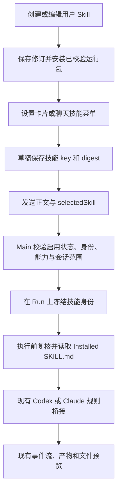

# Skill 场景目录、创建编辑与会话选择实现方案

日期：2026-10-26（Asia/Shanghai）

状态：首版代码及本地验收完成；应用与独立 Skills 仓库的改动均未提交、未推送。验证边界与原有失败项见末尾。

实施记录（2026-10-26）：

- 设置页已接入探索/我的、六个场景、GitHub 安装/本地导入、搜索/来源/排序、卡片详情、创建编辑、复制和既有安装管理。
- 编辑器支持图标、多段指令/排序、资料与技能引用、固定模型/自动、输入提示、四张展示图片与预览、描述、AI 字段建议及撤销；草稿、修订冲突、幂等提交和发布中断恢复由 Main 管理。
- 聊天和 Project 的选择使用 `{key, digest}`，由 Main 解析并冻结到每个 Run；规则、依赖、模型以及历史消息贯穿实际执行。运行前复核已安装包；不自动换用更新版本。预热同样使用会话锁定的模型。
- 来源边界已纠正：App 技能库的 12 项定义、指令和辅助脚本独立维护在 `config/skill-library/`，不属于 GitHub 来源 `cctools-skills`。构建时生成 `.build/skill-library`；安装记录使用 `builtin` 来源和 `openmind-library` 发布者。此前误加到外部仓库的包已移出本地工作区。
- 自建源保存在内容根 `.agent/authored-skills/<uuid>/`，运行包在 `.agent/skills/`，草稿和绑定在按内容根隔离的 userData。默认采集开关限定原包集合，保留场景包及用户明确保留的导入包。
- Agent 场景包明确继承当前会话权限。固定模型仅使用探测到的模型并保留已有保存值，绑定当前 Provider 类型和模型 ID；服务配置仍沿用当前默认/既有会话锁定配置。与旧会话不兼容时保留草稿并提示新建会话。
- 返回编辑页内入口有未应用确认；切换外层设置页面时会保存草稿。冲突时保留编辑内容和错误，用户可退出重开。此次没有增加自动创建新会话的确认流程。
- 真实媒体验证：标准库脚本生成 PPTX 并验证 ZIP/XML；生成 H.264 MP4 并以 ffprobe 验证尺寸/编码。ffmpeg 缺少 drawtext 时使用临时独立 Electron 配置渲染帧。尚未验证 Office 实际显示及真实付费 AI/图片服务。
- UI catalog 已加入目录、我的、编辑器和聊天菜单，覆盖浅/深色及 720/1280 宽度；Linux 运行截图和布局断言，Windows/macOS 像素基线待在对应平台人工评审。没有覆盖更新既有基线。
- 全量单测首轮 2701 项：2694 通过、4 跳过、3 失败。新增包清单断言已修复并复验；其余两项外部包链路失败在修改前 HEAD 的独立临时检出中同样复现（X 包硬编码旧版本、日报链路未渲染预期文章）。后续相关检查结果见文末。

下文保留原方案；以本实施记录及末尾验收结果为当前交付状态。

## 1. 目标与已确定的要求

在「设置 → Skills」内提供一批面向实际任务的 Skill，以卡片展示，并按研究、写作、图片、幻灯片、视频、网页分类。GitHub 安装的 Skill 单独归类；本地目录和 ZIP 导入能力继续保留。

页面顶部增加「探索 / 我的」一级切换，下面保留场景分类。探索用于发现应用提供的场景 Skill，我的用于管理当前内容根中已安装或自己创建的 Skill。

用户可以从设置中的卡片，或聊天输入框的技能菜单选择 Skill。选择后，输入框显示技能标签和专属输入提示；发送时应用加载该 Skill 的真实规则，由当前 AI 执行。

在同一设置模块中增加创建和编辑能力，支持名称、副标题、分类、多段指令、执行模型、输入提示、展示图片和描述。编辑结果保存为用户自己的 Skill，并进入同一目录和会话选择链路。

参考图分别对应：

| 参考图 | 本期实现 |
| --- | --- |
| 图1 | 设置内的分类、搜索、技能卡片、详情与使用入口 |
| 图2 | 输入框技能按钮、可搜索的已安装技能菜单、管理技能入口 |
| 图3 | 输入框已选技能标签、切换/移除、专属 placeholder、模型与能力状态 |
| 补充编辑图 | 技能创建/编辑表单、多段指令及排序、执行模型、最多四张展示图片、输入提示和描述 |
| 顶部分组图 | 技能标题旁「探索 / 我的」一级切换，与下方场景分类独立 |

参考图提供信息结构和交互顺序。颜色、字体、间距、圆角、弹层和动效使用 OpenMind 现有设计系统，不复制参考产品的视觉皮肤。

首版交付包括可实际运行的首批 Skill、目录 UI、创建/编辑、选择交互和执行链路。只增加卡片或把 `/skill-id` 换成标签，不能算完成。

公开投稿、账号社区、收费和热度排行不属于本期范围。截图中的第三方 Skill 名称和内容不直接复制为应用预设。

## 2. 当前源码与可复用能力

以下是当前实现，不是待新增功能：

| 能力 | 入口/实现 | 本次处理 |
| --- | --- | --- |
| 设置内 Skills 页面 | `renderer/src/features/settings/SettingsPage.tsx` → `features/skills/SkillsPage.tsx` | 保留入口，将主体升级为分类卡片目录 |
| Git、本地目录、ZIP 安装 | `shared/skill-package-sources.ts`、`electron/skills/skill-source-service.ts` | 复用检查、选择包、安装、更新流程 |
| 已安装包、来源和启用状态 | `installed-skill-repository.ts`、`installed-skill-source-repository.ts`、`installed-skill-preferences-repository.ts` | 保持现有事实来源；不从卡片文案反推安装状态 |
| `/` 搜索与选择 | `renderer/src/features/ai-console/composer.tsx`、`composer-suggestions.ts` | 增加按钮入口，两种入口调用同一个选择动作 |
| 完整规则加载 | `installed-skill-execution-resolver.ts` → `providers/skill-bridge.ts` | 继续读取校验后的 Installed Skill `SKILL.md` |
| Provider 接入 | `claude-agent-sdk.ts`、`codex-app-server.ts` | 复用现有桥接，不另建 Agent 执行器 |
| 普通与 Project 会话 | `ai-context.tsx`、`ProjectTasksPanel.tsx`、`scheduler.ts` | 两条发送路径都要携带技能选择 |
| AI 图片工具与模型选择 | `electron/ai/image-tool.ts`、`ComposerModelPicker.tsx` | 图片 Skill 复用既有图片服务配置 |

当前选择 Skill 只会插入 `/skill-id`；没有独立的已选技能草稿状态、场景卡片元数据、技能专属 placeholder，或随 Run 保存的显式技能身份。

以源码为准：`AiSession.skillSnapshot` 会在每次任务开始前刷新。现有部分注释仍描述为会话创建时冻结，实施时需同步修正，避免将目录快照误当作某个历史 Run 的执行身份。

## 3. 分类与来源规则

### 3.1 一级视图：探索 / 我的

技能标题旁使用共享 `SegmentedControl variant="compact"`，提供「探索」「我的」两个视图；不是将这两个入口塞进场景分类或来源下拉框。

| 视图 | 显示范围 | 主要动作 |
| --- | --- | --- |
| 探索 | 随应用提供的场景目录，包含未安装和已安装预设 | 浏览、搜索、查看详情、安装并使用、复制为我的技能 |
| 我的 | 当前内容根已安装的预设、GitHub/本地导入包、用户创建的生效版本及其草稿 | 使用、编辑、继续草稿、启用/关闭、更新或卸载、删除用户技能 |

首次进入默认「探索」，随后按内容根记住上次视图。「探索」首版使用随应用发布的预设目录，不引入公开投稿或社区后端；「我的」不展示尚未安装且未创建的目录项。停用或依赖缺失的已安装项仍在「我的」中显示其实际状态。

同一已安装预设可在探索中显示「已安装」，并出现在我的中供管理；它是同一个包身份，不生成两份安装记录。卸载后仍可在探索中重新安装，在我的中移除其安装项；用户另存的编辑副本独立保留。

### 3.2 二级分类：场景与安装来源

下方采用共享 `Tabs variant="pill"`。「探索」显示全部及六个场景；「我的」再增加 GitHub 安装和本地导入：

```text
探索：全部 · 研究 · 写作 · 图片 · 幻灯片 · 视频 · 网页
我的：全部 · 研究 · 写作 · 图片 · 幻灯片 · 视频 · 网页 · GitHub 安装 · 本地导入
```

| 分类 | 范围 |
| --- | --- |
| 研究 | 预设与用户创建的资料整理、对比和研究类 Skill |
| 写作 | 预设与用户创建的写作、改写类 Skill |
| 图片 | 预设与用户创建的图片生成、编辑类 Skill |
| 幻灯片 | 预设与用户创建的演示结构、演示文件生成类 Skill |
| 视频 | 预设与用户创建的分镜、视频制作类 Skill |
| 网页 | 预设与用户创建的网页、小工具制作类 Skill |
| GitHub 安装 | 用户通过 Git 来源安装的普通 Skill，包括现有官方默认包 |
| 本地导入 | 用户通过文件夹或 ZIP 安装的普通 Skill，以及来源不完整的历史安装 |
| 全部 | 当前一级视图中所有目录项的去重合集，保留每项的分类/来源标签 |

Git 安装器也支持其他公开 HTTPS Git 主机。该视图的说明写为「来自 GitHub 等 Git 仓库」，详情始终显示实际主机，不能将 GitLab 等来源标为 GitHub。

每个预设或用户创建的 Skill 首版只有一个主分类；创建/编辑时明确选择，不按名称关键词自动分类。普通导入包不因 `group: image` 等第三方声明自动进入应用场景分类。

在「我的」的全部及场景分类中增加共享 Select 来源筛选，支持「全部来源、应用预设、我创建的、导入的」；GitHub/本地来源分类内不再叠加矛盾的来源选项。「探索」全部为应用预设，不显示重复的来源筛选。卡片标明来源；「我创建的」与「我安装的」均属于我的，不能把我的仅定义为自己编写的内容。

### 3.3 场景分类和真实来源分别存储

场景分类是产品元数据；Git/目录/ZIP 是包的真实安装来源，两者不能使用同一个字段。

应用提供的场景 Skill 即使通过 Git 分发，也只有在「场景目录安装」流程写入并校验专门绑定记录后，才显示在对应场景分类。详情仍披露其实际 Git 来源、版本和安装状态。

普通 Git 导入，即便仓库恰好也是 `cctools-skills`，仍归「GitHub 安装」。不能仅凭仓库 URL、Skill 名称或第三方自报字段将其升级为应用预设。

每个视图内的「全部」按包逻辑 key 和目录绑定去重：一个预设卡片关联到已安装包时只显示一次。相同包已由用户手动安装的，先核对 key、版本、digest；用户点击目录内的安装/关联动作后才能建立预设绑定，不能覆盖另一身份或静默替换版本。

用户创建项由 Main 的作者记录识别，显示在所选场景分类中；虽然生成的包通过本地安装器激活，也不归为普通「本地导入」。复制编辑的外部包保留原来源追溯信息，原包继续留在原来源分类。

### 3.4 搜索与排序

- 搜索当前一级视图和二级分类，覆盖标题、简介、Skill ID、发布者及 Git 来源。
- 两个视图分别保留分类、关键词、排序和滚动位置；分类切换保留该视图关键词，清空搜索只清关键词，结果数也以当前视图为准。
- 我的停留在 GitHub/本地分类后切到探索，使用探索上次有效分类或全部；返回我的可恢复原分类，不能用不可见分类过滤出空白页面。
- 默认按目录预设顺序展示场景 Skill；导入包按名称稳定排序。
- 排序选择提供「默认、名称、最近更新」，更新时间必须来自真实目录版本或安装记录，不伪造热度和使用人数。
- 中英文分类名和界面文案来自 `shared/messages/zh-CN/` 与 `en/`；协议 ID 不随语言变化。

## 4. 首批 Skill 内容与交付要求

首批规划 12 项，每个场景至少 2 项。下表是待编写、验证的产品清单，不能视为当前独立 Skills 仓库已具有这些包。

| 分类 | Skill ID（拟定） | 名称 | 主要输入 | 实际输出/依赖 |
| --- | --- | --- | --- | --- |
| 研究 | `om-research-brief` | 资料研究报告 | 问题、资料、研究范围 | 有来源说明的 Markdown 报告；联网资料按实际浏览能力准备情况启用 |
| 研究 | `om-source-compare` | 多资料对比 | 两份及以上资料、比较维度 | 对比表、证据与差异分析；复用当前资料读取路径 |
| 写作 | `om-article-writer` | 长文写作 | 主题、受众、素材、风格 | 完整文章；遵守现有 Markdown 产物协议 |
| 写作 | `om-text-rewriter` | 改写与润色 | 原文、目的、语气 | 改写正文及必要修改说明 |
| 图片 | `om-poster-maker` | 主题海报 | 主题、文案、比例、参考图 | 实际图片；需要已配置的图片服务和模型 |
| 图片 | `om-image-editor` | 图片风格编辑 | 图片、风格、保留要求 | 实际编辑后图片；校验当前模型是否支持参考图 |
| 幻灯片 | `om-slide-outline` | 演示内容策划 | 主题、受众、页数、资料 | 逐页结构、讲稿与视觉建议，明确为内容方案 |
| 幻灯片 | `om-slide-deck` | 演示文稿制作 | 主题或大纲、品牌要求 | 可打开的演示文件；需随包交付并验证具体制作/导出工具 |
| 视频 | `om-storyboard` | 短视频脚本与分镜 | 主题、时长、比例、风格 | 可执行的分镜和旁白方案，明确为内容方案 |
| 视频 | `om-short-video` | 短视频制作 | 分镜、素材、时长 | 实际可播放视频；需明确制作引擎、运行时和必要媒体能力 |
| 网页 | `om-landing-page` | 落地页制作 | 产品、内容、参考风格 | 可预览的网页文件；使用当前任务允许的输出目录 |
| 网页 | `om-mini-tool` | 交互小工具 | 使用场景、交互要求 | 可运行的网页工具及必要资源 |

每项至少交付：`SKILL.md`、必要参考文件/脚本、适用输入、输出约定、依赖声明和端到端验收样例。需要 Process/Workflow 能力时继续支持 `cctools.skill.yaml` 及兼容的 `openmind.skill.yaml`；普通 Agent Skill 不强加新的私有 Manifest。

生成图片、演示文件和视频必须验收真实文件。仅有大纲、代码片段或提示词时，不能将对应「制作」Skill 标记为可用。具体引擎和导出工具在编写包时核验，不能因为选择了某个语言模型就假定具备视频渲染能力。

封面使用原创、可随应用分发的资源，先采用符合 OpenMind 风格的图标与示意封面。封面缺失有统一占位；不依赖随机远程图片来维持目录布局。

## 5. 设置 → Skills 的页面与交互

### 5.1 页面结构

保留设置导航和标题区域。第一行是「技能」标题、「探索 / 我的」一级切换、搜索和「创建技能」等操作；下面依次是当前分类标题、分类 Tabs、来源筛选/结果统计/排序、技能卡片网格。「导入技能」保留为明确入口，成功后定位到我的对应来源分类。

卡片包含封面、标题、两行简介、分类/来源、真实可用状态和操作入口。卡片主区域打开详情；「使用技能」和「安装并使用」是独立共享 Button，不在可点击按钮内部嵌套另一个按钮。

网格依据设置内容容器宽度自动排布，宽屏多列，窄屏一列；分类可横向滚动。不会为复刻截图强制四列，也不要求用户扩大整个设置窗口。

### 5.2 卡片状态

| 状态 | 展示与动作 |
| --- | --- |
| 预设未安装 | 展示简介和依赖；主动作「安装并使用」 |
| 已安装、启用、可运行 | 「使用技能」 |
| 已安装但关闭 | 「启用并使用」；必须调用既有启用 API，不能只改 Renderer 状态 |
| 依赖/配置缺失 | 展示具体原因及对应配置入口；保留详情，不伪装可执行 |
| 正在安装/更新 | 显示当前请求进度，避免重复提交 |
| 安装/更新失败 | 展示可重试错误，不丢失当前分类与搜索 |
| 包已被替换、移除或校验失败 | 停止使用入口并刷新状态，不能自动退回同名工作区文件 |
| 用户 Skill 尚为草稿 | 显示「继续编辑」，不进入可执行列表 |

只浏览目录不安装包、不启动任务、不生成媒体。点击使用也不立即发送消息。

### 5.3 详情与既有管理功能

卡片打开共享 `Dialog` 组成的 `SkillDetailDialog`，展示用途、输入示例、规则说明、能力需求、来源、版本和操作。

用户创建的 Skill 提供「编辑」「复制」「删除」；应用预设和导入包提供「复制为我的技能」，进入同一个编辑器。原始外部包的更新、卸载仍使用现有管理操作。

从现有 `SkillsPage.tsx` 提取并复用启用开关、来源配置、运行记录和更新操作。RSS、Reddit、X 等专有配置继续由原功能组件持有请求和校验逻辑，不因改为卡片丢失。

「我的 → GitHub 安装」保留按仓库查看、检查更新和更新包的能力。官方默认 Skill/采集任务开关放在该视图明确的管理区域，「我的 → 全部」提供可发现的管理入口。

### 5.4 从设置使用 Skill

- 从聊天菜单「管理技能」进入「设置 → Skills → 我的」，记录原会话/Project 草稿目标；点击使用后返回该目标并挂上 Skill。需要安装新技能时可直接切换探索。
- 直接打开设置后点击使用，进入普通 AI 新会话草稿；已有新会话草稿内容和附件保留，只更换显式选择。
- 不将普通设置操作隐式写入当前 Project。若该目标已有不同 Skill，切换标签但保留用户正文；不覆盖其他会话或 Project 草稿。
- 返回后聚焦输入框，展示专属 placeholder。示例输入通过明确的「填入示例」动作使用，不自动填入或发送。
- 使用 `AppRouteState` 和类型化回调传递目标及选择请求；不通过剪贴板、URL 中的完整规则或无类型全局事件传递。
- 路由状态增加类型化的 `skillLibraryMode` 与分类字段；从创建、编辑、导入和聊天管理返回时恢复正确视图，不由页面标题或来源文案推断。

### 5.5 创建与编辑界面

编辑器在「设置 → Skills」内部切换为完整编辑视图，保留设置导航，顶部提供返回、创建/保存和取消。长表单使用内容区域滚动；窄窗口将名称与副标题从两列改为一列，不把整个表单塞进小弹窗。

创建与编辑共用同一个 `SkillEditor`，字段、布局和校验一致。新建时初始化一段空指令、自动模型和空展示图；编辑时回填已保存的全部字段、指令顺序、资料/技能引用、模型及图片。存在未应用草稿时明确显示草稿与生效版本，不能用空表单覆盖已有内容。

按补充截图确定表单顺序：图标与顶部操作 → 名称/副标题及分类 → 指令组 → 执行模型 → 输入提示 → 展示图片 → 描述。执行模型属于整个 Skill，位于指令组外；描述保留较大的多行编辑区域。分类使用现有 Select 补入基础信息区，其他控件继续使用当前项目的尺寸和样式。

字段与约束如下；截图明确的字数和图片数量沿用，其余为本方案建议的首版上限，统一由共享 schema 管理：

| 字段 | 编辑方式 | 校验与用途 |
| --- | --- | --- |
| 技能图标 | 共享图标选择或本地图片导入 | 可选；未指定时使用分类图标 |
| 技能名称 | Input | 必填，不超过 40 字；在当前内容根的「我创建的」中唯一；不是磁盘目录名或执行 ID |
| 副标题 | Input | 不超过 60 字，作为卡片短简介；留空时使用描述摘要 |
| 分类 | Select | 六个场景中必选一项；GitHub/本地来源不可手选伪造 |
| 指令 | 多个有稳定 ID 的 Textarea 块 | 至少一段非空指令；建议最多 20 段、每段 20,000 字、总计 100,000 字 |
| 执行模型 | Select / 复用模型选择表面 | 默认「自动」；可选择当前已配置且兼容的执行模型，保存为该 Skill 的偏好 |
| 输入提示 | Textarea | 不超过 200 字；只用于 Composer placeholder，不自动当成用户输入 |
| 展示 | FileDropzone + ImageThumbnail/ImageViewer | 最多 4 张图片，支持预览、移除和排序；首张默认作为卡片封面 |
| 描述 | Textarea | 说明用途、输入和结果，建议不超过 5,000 字；不自动升格为执行指令 |

名称唯一检查只针对当前内容根中用户创建的记录，编辑时排除自身。ID 在创建时由 Main 生成，改名不改变 ID、引用关系或安装 key。字数统一按 Unicode 码点计算，前后端使用同一实现。

图片建议仅接收 PNG/JPEG/WebP，单张不超过 10 MiB；校验实际文件内容并复制进 Skill 资源目录。截图展示图和图标是产品展示资料，不自动成为每次会话的图片附件。

展示区域实时显示 `n/4`：空状态为 `0/4` 加添加入口，导入成功后显示真实缩略图；四张时禁用添加，删除后恢复。重新打开编辑器保留图片顺序和封面选择。查看图片使用现有 ImageViewer；导入失败保留已有图片，不能将占位图计为已上传内容。

字段旁的说明图标使用共享 Tooltip；AI 辅助操作与字段输入分别提供可读名称。名称、副标题、输入提示和描述是不同字段，保存后分别服务于技能标签、卡片简介、聊天 placeholder 与详情说明，不能把它们合并成一段正文。

### 5.6 多段指令、资料与技能引用

- 「添加」新增指令块；每块支持上移、下移、删除，重排后内容、引用和光标状态绑定稳定块 ID。
- 每块的「添加资料」选择参考文件，通过 Main 导入副本并返回资源 ID。文本、Markdown、图片可直接引用；其他文档复用经验证的转换器，不能以绝对路径留一个易失引用。
- 每块的「引用技能」打开同一目录选择表面，保存被引用包的 key、version、digest，不把整个规则正文塞进 Renderer 状态。
- 引用需要解析依赖图，拒绝自引用和循环；建议最多三级、去重后最多十个依赖。保存时和运行前都重新校验，旧版本不自动换成新版。
- 多段指令表示按顺序组织的同一套规则，不代表每段单独启动一个 Agent、切换模型或开启工作流。生成规则保留块顺序，并声明资料和技能引用的作用范围。
- 会话接纳时冻结引用依赖的身份；Main 通过现有规则桥提供已校验引用。依赖缺失、禁用或被替换时说明具体项，不静默忽略。

指令 placeholder 可提示目标、风格、背景、关键词和输出长度，但这些提示不是保存后的默认规则。空白块可在保存时去掉，全部为空时不能创建。

截图中的 AI 辅助按钮对应真实的字段建议：用户主动请求后，利用现有 Provider 执行桥生成名称、副标题、输入提示或描述候选。显示候选供采用，保留原值与撤销能力；不自动覆盖，不把按钮做成无行为的装饰。辅助任务与用户正在进行的会话隔离，结构化结果仍按相同字段约束校验。

### 5.7 保存、退出与版本生效

「创建」/「保存并应用」校验表单、资料、技能引用及模型偏好，成功后创建新修订、生成可安装 Agent 包并进入既有安装/校验通道；随后刷新卡片与聊天目录。失败保留编辑内容，并指出是字段、依赖、安装还是模型配置问题。

新建模式显示「创建」，编辑模式显示「保存并应用」；无修改时禁用保存，提交中防止重复提交和意外关闭。校验失败显示对应 FormField 错误并聚焦首个错误项。保存成功后，卡片、详情、重新打开的编辑器和聊天选择器都读取同一已生效版本，不能只更新当前表单。

新建或复制成功后定位到「我的」中对应场景的用户技能；编辑返回原我的视图并定位该卡片。从探索复制不会将个人副本放入探索目录，导入 Git/本地包则分别定位到我的来源分类。

编辑草稿自动保存到 app-private 状态；草稿与已生效版本分别显示。未发布草稿不进入 AI 可执行目录。取消、返回或关闭设置时若有未应用修改，复用现有未保存变更保护，可保留草稿、放弃修改或返回继续编辑。

保存更新必须携带编辑开始时的 revision，Main 检查并发修改，冲突时保留本地草稿，提供加载新版/另存副本。提交使用操作 ID 和可恢复回执；生成或安装失败保持原生效包，应用重开后可核对是否已经提交，避免重复创建。

删除用户 Skill 先使用共享 ConfirmDialog，按现有运行状态与包卸载策略处理正在使用的版本；默认不删除已生成产物。删除后引用它的其他 Skill 显示依赖缺失，不能继续伪装就绪。

## 6. 聊天输入框交互

### 6.1 技能选择菜单

在现有附件按钮旁增加带 Tooltip 的 Skill `IconButton`。打开锚定弹层，提供搜索、场景/来源分组、已安装技能和「管理技能」。

默认列出已安装且启用的技能。当前任务缺少能力的条目可以展示原因和配置入口，但不能作为已就绪项发送。未安装预设在设置中安装，聊天菜单不因悬停或输入而访问 GitHub。

菜单复用共享 `Popover`/`PopoverSurface`、`SearchInput`、`MenuItem` 及 `useDismissableLayer`。选择列表可以在同一弹层内显示，避免为复制参考图引入多层悬停菜单；需要分级时，小窗口必须允许在同一面板中前进/返回。

菜单支持键盘上下移动、Enter 选择、Esc 关闭并归还焦点，点击外部关闭。IME 输入期间 Enter 不触发选择或发送。

保留 `/` 快捷入口：从其候选项选择时，调用相同的 `selectSkill` 动作，将触发文本转换为已选标签。手动输入完整旧式 `/skill-id 参数` 的用法继续兼容。

### 6.2 已选状态

选中后显示技能图标、名称、切换入口及移除按钮。标签位于 Textarea 下方工具栏，不覆盖正文滚动区域；模型、权限、附件和发送按钮继续沿用现有排布。

Skill placeholder 仅在正文为空时生效，不能作为用户消息内容发送。选中或切换 Skill 不改写已有正文和附件。

首版一次消息显式选择一个 Skill，规则在该任务的整个 Agent 执行过程中有效。发送成功后清空本次正文、附件与选择；发送失败全部保留。后续消息可再次选择，不额外增加永久绑定整个会话的模式。

| 事件 | 状态变化 |
| --- | --- |
| 选择 Skill | 保留正文/附件，设置技能引用并关闭菜单 |
| 切换 Skill | 仅替换引用，更新标签、提示和能力状态 |
| 移除 Skill | 清除引用，恢复通用 placeholder，保留正文/附件 |
| 切换会话/Project | 保存原草稿，读取目标草稿，互不继承选择 |
| 发送成功 | Run 留下技能身份快照；清空本次草稿选择 |
| 发送失败 | 保留正文、附件、选择及可操作错误 |
| 选择后包被更新/停用/卸载 | 将原选择标为失效，发送前要求刷新/重新选择，不静默改用新版 |
| 重开应用 | 恢复草稿引用；重新检查当前安装状态，不能仅凭旧标签判断可用 |

### 6.3 模型与权限

当前模型面板同时选择 AI Provider 和图片生成模型；Agent 的 `providerModel` 当前由调度器解析，并没有现成的每 Skill 模型绑定。编辑器的执行模型需要增加真实协议，不能只保存一个展示字符串。

- 编辑器选择「自动」时，Skill 保留用户当前 AI 模型/Provider。
- 选择固定模型时，记录当前已配置的 Provider/profile 身份及模型 ID，不保存密钥或任意服务地址；发送前由 Main 再校验可用性。
- 新会话按该 Skill 的有效模型偏好创建；模型面板展示实际将执行的选择，不修改全局默认设置。
- 需要图片能力的 Skill 复用 `ImageSelection` 和现有图片服务选择；未配置时提供现有设置入口。
- 既有会话继续锁定其 Provider/profile；固定模型与该会话不兼容时，提供保留正文、附件、Skill 和所属 Project 的新会话/任务入口，不暗中切换后端或重建会话。
- `StartRunInput`、Project 请求、Run/turn 快照、Provider context 与预热缓存键都需携带或解析实际执行模型；运行及重试使用冻结结果，而非执行到一半重读全局默认模型。
- 配置被移除或更新时显示具体原因，按现有 Provider 配置变更处理；不为复刻截图硬编码某个 Opus 版本。
- Skill 所需写入/执行能力与当前只读或计划模式冲突时明确提示；不能自动提高权限。

选中 Skill、选择模型和运行工具是三个独立动作；标签和模型名称都不能证明任务已经执行成功。

## 7. 目录、规则来源与存储边界

### 7.1 两个技能来源的职责

`openmind-app/config/skill-library/` 保存应用技能库的 JSON 定义、执行指令、中英文展示信息及可选辅助脚本。构建器从这些定义生成安装包，不读取外部仓库。

`cctools-skills` 是经 GitHub 导入的外部来源，其规则、脚本和更新独立维护，不承载应用技能库。用户在编辑器创建的内容属于其数据仓库，按 7.4 保存，不提交到这两个源码位置。

预设目录随应用发布，浏览可离线。首次使用未安装项时，调用现有安装器安装指定包；既有安装不因启动、切分类或搜索被自动更新。运行时安装使用构建时固定的逐包 digest，不从 `main` 即时下载。CI 直接从 App 内配置生成 bundle，无需检出 `cctools-skills`。应用技能安装记录与 GitHub 导入记录明确区分。

已安装包仍位于 `<openmindRoot>/.agent/skills/`，持久 Skill 数据仍位于 `<openmindRoot>/.agent/skill-data/<skill>/`。目录绑定与应用偏好放 Electron `userData`，产物按当前会话/Project 输出规则存放。

### 7.2 默认 Skill 开关必须拆清管理集合

`DefaultSkillsService` 只管理明确列出的 GitHub 默认技能；应用技能库是独立来源，不能加入该仓库或由其开关管理。关闭默认技能会保留应用技能及用户明确保留的导入包。

因此本期必须一并完成：

1. 为原有默认包建立明确的 packageRef/key 集合，保留原有默认功能覆盖范围；新增场景包使用独立 ID 和集合。
2. 默认服务仅安装和管理原集合；场景目录通过独立入口选择指定包安装。
3. 关闭默认功能仍先停止并等待其运行/排队任务，再移除归其管理的包；不能删除场景目录包。
4. 更新「默认包完整安装」检查和 source receipt 判定，不能再要求将未来仓库中的所有包都装完。
5. 已安装包如果同时被默认服务和用户显式保留，持久记录管理归属；关闭默认功能只解除该归属，不能删除仍由用户使用的安装。两个新集合的 ID 应保持不重叠。

不新增启动安装门槛，也不因新增目录开启采集任务。场景库安装与默认采集任务的开关分别操作。

### 7.3 单一目录服务

新增 Main 侧 `SkillLibraryService`，将应用目录索引、用户作者记录、现有安装记录/启用状态、预设安装绑定和实际能力准备情况合成为同一份 `SkillLibraryEntryView[]`。来源类型区分 preset/authored/git/local，编辑能力从真实作者记录派生，不能由客户端传入的来源标签授予。

设置卡片、聊天菜单、`/` 候选和状态刷新使用同一份身份与状态解析结果；Renderer 不分别维护一套固定技能数组，也不自行读取 `SKILL.md` 或探测文件路径。

预设绑定采用独立的 Main-owned 记录，建议路径为 `userData/catalog/<root-id>/preset-installations.json`。记录目录 ID 与实际安装 key/digest，以及安装流程需要的管理归属。读取时必须再次对照安装事实，记录本身不授予执行权限。

现有普通安装记录无需为了卡片展示强制重写；旧 Git 记录归 GitHub 安装，旧本地/未知来源归本地导入。绑定损坏、丢失或不匹配时不能将包认作可信预设，仍可通过原安装记录管理该包。

### 7.4 用户编辑源与运行包

建议新增 `<openmindRoot>/.agent/authored-skills/<uuid>/` 保存用户 Skill 的编辑源、资源和修订；同步在 `AppPaths`/布局合同中声明其归属。其逻辑内容是用户资产，不放 App checkout，也不混入安装器会整目录替换的 `.agent/skills/<name>/`。

编辑源保存结构化 `skill.json`、以资源 ID 管理的图片/资料及不可变修订。未应用草稿、事务恢复信息和 UI 状态保存在按内容根隔离的 userData。Renderer 仅使用类型化 IPC 读写，不获得任意文件写权限。

Main 的 `SkillLibraryService`（同时负责作者内容） 将已校验修订生成标准 `SKILL.md` 和包内引用资料，按既有 Agent 包元数据规则声明稳定 publisher/id/version；需要时生成应用已支持的 `cctools.skill.yaml`，不新增另一种规则执行格式。最终经原安装器校验、暂存与切换，安装到 `.agent/skills/`，由同一 resolver 执行。

保存编辑源与激活包分别有状态：规则只在安装提交成功后生效。使用修订号、操作 ID 和恢复记录核对提交结果；不能在失败后让目录显示新规则而运行仍是未标明的旧规则。显示草稿修订与已生效修订，支持继续编辑/重试应用。

预设和 GitHub 包默认编辑副本，生成新的用户 ID，保留原 key/digest/来源作为溯源。副本需要的资料/脚本只能通过 Main 检查后复制或保持明确依赖；不写入原 Installed 包，否则会破坏 digest 和后续更新。

可视化编辑器针对规则型 Agent Skill。已有 Process/Workflow 包不能只编辑一段文字就声称完成原脚本/工作流修改：提供创建 Agent 规则副本并引用原技能的路径，运行依赖仍指向原包；源码级编辑继续走其独立源码维护方式。

## 8. 数据契约与端到端执行

### 8.1 拟新增共享类型

类型与 Zod schema 放 `shared/skill-library.ts`；以下表达契约方向，最终字段需与现有协议共同实现：

```ts
type SkillSceneCategory =
  | "research" | "writing" | "image" | "slides" | "video" | "web";

type SkillLibraryMode = "explore" | "mine";

type SkillLibrarySection =
  | "all" | SkillSceneCategory | "github-installed" | "local-imported";

type SkillSelectionInput = {
  key: string;
  digest: string;
};

type InstalledSkillIdentity = {
  key: string;
  version: string;
  digest: string;
};

type SelectedSkillSnapshot = {
  key: string;
  id: string;
  version: string;
  digest: string;
  title: string;
  catalogEntryId: string | null;
  category: SkillSceneCategory | null;
  authoringRevision: number | null;
  dependencies: InstalledSkillIdentity[];
  source: "picker" | "slash";
};
```

目录定义另有稳定 ID、分类、标题/简介/placeholder 文案键、封面资源 ID、能力需求以及实际发布包的来源、packageRef、revision、digest。UI 中的 view 只暴露展示和选择所需信息；不能将任意规则正文、绝对包路径或凭据作为选择请求传回 Main。

列表查询/派生结果同时处理 `SkillLibraryMode` 与 `SkillLibrarySection`，共享安装事实并按视图去重；页面偏好按内容根和 mode 存储。探索/我的只决定浏览范围，不改变包来源、启用状态或执行权限。

`SelectedSkillSnapshot` 由 Main 校验后生成。Renderer 只提交 key/digest，不得通过构造 title、路径或规则伪造另一个包。

另定义 `AuthoredSkillDocumentSchema`：稳定 UUID、revision、名称、副标题、分类、图标资源、多段指令（块 ID/正文/资源 ID/技能引用）、执行模型偏好、输入提示、最多四张展示图、描述及原始来源。内部版本/发布时间与编辑内容分开，由 Main 维护。

执行模型偏好使用可判别类型：`auto` 或已配置 profile/model 的固定选择。Main 解析后在 Run 保存 `resolvedExecutionModel`（Provider、profile 身份/配置指纹、实际 model ID），并将其用于 Provider context、turn 记录和重试。图片模型继续走既有 `ImageSelection` 字段，不能混入语言模型 ID。

新增的类型化 IPC 至少涵盖：列目录、读取编辑源、保存草稿、创建/应用修订、复制技能、删除用户技能、导入编辑资源、字段 AI 建议。保存/发布请求包含 root 作用域、稳定 ID、期望 revision 和操作 ID；资源接口返回应用资源 ID，不接受客户端任意指定目标绝对路径。

### 8.2 草稿与发送协议

扩展现有草稿存储为版本化记录，例如 `{ text, selectedSkill }`，对旧字符串记录进行兼容读取。草稿按内容根、会话/Project 目标隔离，继续使用应用私有持久化位置。

`selectedSkill` 贯穿以下所有边界，不仅修改聊天组件：

| 边界 | 修改位置 |
| --- | --- |
| Composer 提交 | `ChatDraftSubmitInput`、`ai-context.tsx` 的 `SendOptions` 与 `send` |
| 普通聊天请求 | `shared/contracts.ts` 的 `StartRunInputSchema`、`DesktopApi` |
| Project 请求 | `ProjectStartTaskRunInputSchema`、`projects-api.ts`、`ProjectTasksPanel.tsx` 的新建/继续路径 |
| IPC | `shared/ipc-channels.ts`、`ipc-registry.ts`/`ipc-bridge.ts`、`electron/preload.ts`、`ipc-handlers.ts` |
| Worker 与调度 | AI Worker 请求桥、`worker.ts`、`scheduler.ts` 的两种会话调度入口 |
| 持久化 | `AiRunSchema`、`session-store.ts` 的创建、读取、分支、复制、实际模型及历史事件 |

`StartRunInput` 与 Project 输入新增可选 `selectedSkill`；缺省/null 表示没有按钮显式选择。`AiRun` 新增默认 null 的已校验快照，旧记录兼容读取。该字段与会话层的 `skillSnapshot` 分开，不能混用。

### 8.3 执行流程



调度接纳请求时解析并校验显式引用，随后在 Run 上保存身份。排队期间更新目录或切换输入框选择，不会改变已接纳 Run 的 Skill。

执行前通过 `InstalledSkillExecutionResolver` 复核该 key/version/digest，读取规则与参考文件，并复用当前 `ProviderSkillBridge`。如果旧版本已被替换或卸载，明确失败；不能自动运行相同 ID 的新版本。

用户编辑产生的新版本只影响随后选择的任务；已运行任务保留其已加载规则，尚未执行且旧包已被替换的任务按版本失效处理。被引用技能同样在接纳时冻结、执行时复核；取消当前标签不会删除会话历史中已有的消息与规则上下文。

`scheduler-execution.ts` 中的执行、token 估算/预处理等解析路径统一改为优先使用 Run 快照，不能仍只依赖实时会话目录。`skillCatalog` 继续用于自动发现；显式规则与自动发现元数据各负其责，不重复注入完整规则。

### 8.4 旧斜杠命令、重试与历史

- 没有结构化选择的旧 `/skill-id 参数` 请求继续解析，并生成同样的已校验 Run 快照。
- 同时存在标签与手动斜杠时，若身份一致则只解析一次；若指定不同 Skill，明确提示冲突，不隐式覆盖。
- 用户消息正文保留用户实际输入，技能以独立标签显示；不把完整规则塞入用户正文。旧历史含前缀的正文保持原样。
- 重试使用原 Run 身份；原包不可用时提示重新选择，不能悄悄重试新版。编辑重发恢复原文、附件及引用，再做可用性检查。
- 分支/复制历史保留每条 Run 的快照，目标草稿不继承其他会话的未发送选择。
- 持久化事件/turn 记录技能 ID、版本与 digest，历史标签使用当时的标题快照；目录改名、删除、切语言不会篡改旧消息内容。
- 使用现有 Markdown 产物、`openmind-deliverables`、图片资源和最终文件选择协议；Skill 标签不创建另一套产物通道。

## 9. UI 组件与样式落点

| 场景 | 复用组件/约定 |
| --- | --- |
| 探索 / 我的 | `SegmentedControl variant="compact"` |
| 分类 | `Tabs variant="pill"` |
| 目录和菜单搜索 | `SearchInput` |
| 排序与现有模型选择 | `Select`、`ComposerModelPicker` |
| 编辑字段 | `FormField`、`Input`、`Textarea`、`Select`，引用指令块保持稳定组件身份 |
| 图标/资料/展示图 | 共享图标选择、`FileDropzone`、`ImageThumbnail`、`ImageViewer` |
| 卡片动作 | `Button`；卡片选择区域使用明确 ARIA 的导航/选择表面 |
| 输入框技能入口/移除 | `IconButton`、共享 Tooltip |
| 技能菜单 | `Popover`/`PopoverSurface`、`MenuItem`、`useDismissableLayer` |
| 详情和安装确认 | `Dialog` + `DialogHeader/Body/Footer`；标准确认使用 `ConfirmDialog` |
| 标签 | 组合现有 Button/IconButton，必要的公共 variant 按组件契约扩展 |
| 展开与动效 | `AnimatedDisclosure`、现有 motion tokens、reduced-motion |

页面布局和卡片内容结构放 `renderer/src/styles/features/skills.css`；Composer 只在其既有样式文件扩展布局。共享控件的颜色、字体、内边距、高度和交互状态继续由单一组件 CSS owner 管理。

新增控件 variant 时同步修改 `control-contract.ts`、production component catalog、行为测试与人工审核的视觉基线。禁止功能 CSS 覆写控件内部外观；固定样式不写 inline style。

弹层约束在可视区域内，支持滚动、窗口缩放与窄侧栏。表单、菜单和标签均保留焦点可见性；所有新增图标动作有可读名称。

## 10. 实施顺序与文件范围

| 阶段 | 交付 | 主要文件/位置 |
| --- | --- | --- |
| 1：身份与目录 | 分类协议、目录索引、统一 view、预设绑定及默认包管理范围 | 新 `shared/skill-library.ts`、`shared/skill-library-catalog.ts`、`electron/skills/skill-library-service.ts`、绑定记录仓库；现有 default/source 服务 |
| 2：用户内容 | 编辑源 schema、修订与资源、生成运行包、复制与依赖校验 | `electron/skills/skill-library-service.ts` 内的作者记录/修订/恢复，布局合同与 AppPaths |
| 3：执行协议 | structured selection、依赖/模型/Run 快照、普通/Project IPC、兼容旧命令 | `shared/contracts.ts`、`project-contracts.ts`、IPC/Worker、`scheduler.ts`、`scheduler-execution.ts`、`session-store.ts`、Provider context |
| 4：设置目录 | 探索/我的、二级分类搜索、网格卡片、详情、安装/启用并使用、保留旧包配置 | `features/skills/` 拆分组件、`SettingsPage.tsx`、`AppRouteState`、`App.tsx`、`styles/features/skills.css` |
| 5：编辑 UI | 创建/编辑、多段指令、模型、资源、AI 字段建议、未保存保护 | 新 `SkillEditor.tsx`（内含指令块编辑）、共享控件与消息目录 |
| 6：聊天交互 | 技能按钮、菜单、标签、placeholder、草稿和模型能力状态 | 新 `ComposerSkillPicker.tsx`（内含选择标签）；`composer.tsx`、`ai-context.tsx`、Project 提交路径 |
| 7：首批内容 | 12 个真实包及其依赖、示例输入、封面和发布身份 | 独立 `cctools-skills` 仓库；App 只提交目录元数据和可分发展示资源 |
| 8：验收 | 集成、真实组件视觉、包与产物验证 | 现有及新增对应测试、UI catalog、临时 userData 的 Electron fixtures |

阶段可以分提交；协议与完整技能身份必须先于交互接通，避免 UI 看似选中而后端未收到选择。首批内容的规则与依赖可在上述工作期间编写，但实际发布索引必须等对应包验证后填写。

实施保留工作区已有的 UI 契约、Project 和视觉脚本改动，未回滚或提交这些改动。

## 11. 验收与完成标准

### 11.1 产品验收

1. 设置 → Skills 顶部展示探索/我的；下方显示当前视图的六个场景分类与全部，我的额外有 GitHub 安装和本地导入；现有包迁移后没有丢失或被误归类。
2. 六个场景分类各有至少两项真实内容；卡片有正确用途、状态和依赖信息。
3. 搜索、排序、详情、安装/更新、启用/关闭、来源配置及历史记录仍可正常使用。
4. 从设置卡片或输入框菜单选择 Skill 后，显示相同技能标签与专属提示，保留正文和附件，且不会立即运行。
5. 普通会话、Project 新任务和 Project 已有任务的后端均收到选择，加载正确 key/digest 的规则。
6. GitHub/目录/ZIP 安装的启用 Skill 也能通过同一聊天菜单使用；手动 `/skill-id` 继续可用。
7. 发送失败、切换会话、应用重开和窗口缩放时，草稿与选择符合既定规则，不串会话。
8. 更新/禁用/卸载已选包后有明确反馈；排队 Run 不被替换为新版规则，重试不丢失身份。
9. 缺少图片服务、演示导出工具或视频引擎时提示具体缺失项，不宣称已生成文件。
10. 默认采集任务开关不安装、不删除场景目录 Skill；原有默认任务的取消顺序和功能保持正确。
11. 历史消息可看到当次 Skill，重试/编辑/分支结果一致；真实产物通过现有预览和交付协议展示。
12. 浅色/深色、宽/窄窗口、键盘和 reduced-motion 下均与现有组件风格一致。
13. 创建/编辑支持截图中的全部字段：名称 40 字、副标题 60 字、输入提示 200 字、最多四张展示图片；校验与计数前后端一致。
14. 多段指令新增、排序、删除和资料/Skill 引用在保存、重开、执行后仍一致；循环引用、失效依赖和修订冲突有明确结果。
15. 固定执行模型在实际 Provider 请求中生效；「自动」沿用当前选择，既有会话冲突时不会暗中切换配置。
16. 编辑预设/GitHub 包生成独立用户副本，原包更新不覆盖副本；编辑用户 Skill 保存后真实生成新规则并供会话使用。
17. 草稿恢复、取消、未保存退出、AI 字段建议、删除和安装提交恢复可用，用户正文和资源不因失败丢失。
18. 新建与编辑共用表单，已有内容完整回填；展示图片 `0/4` 至 `4/4`、添加/删除/排序、长描述编辑与保存重开结果一致，卡片和聊天提示同步生效。
19. 探索包含未安装预设，我的包含已安装及用户创建的内容；视图切换恢复各自筛选状态，安装/卸载、创建/复制/编辑、导入和聊天管理返回都定位正确，单个视图内无重复项。

### 11.2 测试重点

- 目录/来源去重、预设绑定校验、旧记录读取以及默认包集合隔离。
- 探索/我的的显示范围、每个视图的分类和搜索恢复、安装状态联动、创建/复制/导入后的导航。
- 结构化选择与旧命令的冲突、重复解析、包身份变更、排队和重试行为。
- Codex/Claude 收到对应完整规则；普通与 Project 的 IPC 字段不丢失。
- 卡片到 Composer 的返回目标、草稿隔离、失败保留、菜单键盘/IME 与焦点恢复。
- 编辑字段校验、名称唯一、多块排序、资源拷贝及预览、草稿恢复与并发修订。
- 技能引用循环/版本失效、编辑副本身份、应用修订失败恢复以及实际模型冻结。
- 原 RSS/Reddit/X 配置和现有来源更新不回归。
- 12 个 Skill 的代表性实际输入/输出；媒体和演示文件需验证可打开/播放，测试替身通过不等于真实能力已验收。

实现后运行适用的定向单元测试、`npm run typecheck`、`npm run check:ui`、`npm run build`、`npm run test:integration`、`npm run test:e2e` 和 `npm run visual:ui`。新增共享组件/variant 的视觉基线需显式生成、查看 actual/expected/diff 后审核，再执行正常比较；不能自动更新基线使 CI 变绿。

所有自动化 UI 和服务测试使用临时 userData、临时内容根及合成 Provider。独立 Skills 仓库测试按需显式设置 `OPENMIND_SKILLS_REPO_ROOT`；真实媒体/外部服务验收单独记录，不读取开发者的真实资料、浏览器状态或凭据作为测试数据。

## 12. 实施前待核验事项

以下不影响本文明确页面与执行方案，但在把对应条目标为可用前必须有真实结果：

- 独立 `cctools-skills` 仓库现有包可复用范围，以及新增 12 项与原有 ID/管理集合是否冲突。
- 演示文件制作与短视频制作的具体工具链、支持平台、包内依赖和产物格式。
- 首批包发布的实际 revision/digest，以及封面资源的可分发来源。
- 当前 Provider/CLI 对每次任务模型选择的实际兼容情况；复用缓存或继续旧会话时必须验证模型与规则都正确。

这些属于实施与验收工作，不用占位 commit、伪造封面数据或只验证卡片渲染来代替。


## 13. 本次本地验收结果

| 检查 | 结果及范围 |
| --- | --- |
| `npm run build`、最终 `typecheck` 和 Main/preload 重编译 | 通过。包含 12 个包的构建校验、样式 owner、13 项 UI 契约、文案审计和所有正式 manifest 校验。 |
| 功能相关单测 | 188 项通过；最后 resolver 本地化与依赖状态调整后，额外复验 21 项通过。覆盖普通/Project 结构化选择、实际规则桥、模型及预热锁定、队列中的旧 digest、编辑/草稿/恢复/复制、IPC 和默认包归属。 |
| 全量单测 | 首轮 2701 项，2694 通过、4 跳过。包清单断言已随新增 12 包修复，后续相关包测试通过；剩余两条独立 Skills 链路失败在原 HEAD 临时检出中复现，不改动其业务逻辑。 |
| `npm run test:integration` | 通过；使用临时数据目录、合成内容及本地 fixture。 |
| `npm run test:e2e` | 真实 Electron/preload/IPC 通过。验证 12 项目录、单个预设安装、创建并重开个人 Skill、删除，以及关闭默认采集后保留场景包。使用独立临时 userData，无真实 Provider 调用。 |
| `npm run visual:ui -- --capture-only` | 84 张截图及布局/交互断言通过；其中新增功能 16 张（四种页面 × 两种主题 × 两种宽度）逐一检查。共享控件 500 次受控更新 P95 为 0.80ms。 |
| `npm run visual:ui` | 当前 Linux 按仓库现有平台策略跳过像素比较；新页面暂为截图/布局场景，原 Windows 基线及清单未更改。Windows/macOS 的新增像素基线仍需对应平台评审。 |
| PPTX / MP4 | 使用本地临时输入生成两页真实 PPTX，所有 XML/关系文件可解析；生成真实 H.264 MP4，经 ffprobe 验证编码、尺寸和时长。未验证 Office 实际渲染及真实 AI 内容质量。 |
| Git / 远端交付 | 仅修改工作区，未 commit、push 或创建 PR。独立 Skills 源码也尚未提交；远端构建前须协调发布该仓库的新包，当前 bundle 的 `sourceDirty` 为 true。 |

真实文本 Provider、AI 字段建议和付费图片服务未实调用；对应请求/规则/输出协议已由合成 Provider 与实际 IPC 验证，不据此声称真实服务已验收。

## 14. 页面风格复核与调整

首次页面截图暴露出标题重复、搜索工具栏不必要换行，以及编辑器在宽窗口中收缩为窄列的问题。复用共享控件不足以保证整个页面与项目风格一致，因此补充以下调整：

- 移除 Skills 内的重复标题，沿用设置页已有标题和说明；探索/我的、搜索、导入和创建在同一工具栏排列，场景分类独立成行。
- 移除目录页的 1260px 特例，目录与编辑页均沿用现有设置页的 980px 内容轴；编辑器显式占满可用宽度，消除自动外边距造成的收缩。
- 将现有设置页私有的 `SettingsPanel` 提取为同目录共享组件，原页面保持相同结构与 CSS owner。编辑页按基本信息、指令、使用与展示分组，沿用同一面板圆角、背景、标题和内边距。
- 保留共享输入、按钮、菜单、Tabs、分段选择及图片控件的既有外观，功能样式只调整布局；缩小缺省封面，改善列表密度。

重新运行类型检查、UI ownership/13 项契约及 49 项设置/Skill 交互测试，均通过。首轮交互测试与构建并发时发生超时，停止构建竞争后以 15 秒测试上限复跑，49 项全部通过。

使用实际生产 renderer、临时 userData 和示例数据重新截取 13 张页面截图，包含原常规设置页对照、探索/我的/GitHub 分类、编辑页上下部分、窄窗口、聊天选择以及深色页面。宽窗口中常规设置、目录和编辑器实测均为 980px；900px 窗口下编辑器与父内容区均为 526px，无横向页面溢出，renderer 错误列表为空。截图为布局和主题的本机验证，不替代 Windows/macOS 像素基线评审。

最终 renderer 构建和样式审计通过；UI catalog 重新完成 84 张截图及布局/交互断言，错误列表为空。窄窗口的工具栏换行规则仅用于目录，编辑页保留返回与保存操作的同行排列；受控更新 P95 为 0.30ms。Linux 的常规像素比较仍按原平台策略跳过，未生成或替换任何基线。
